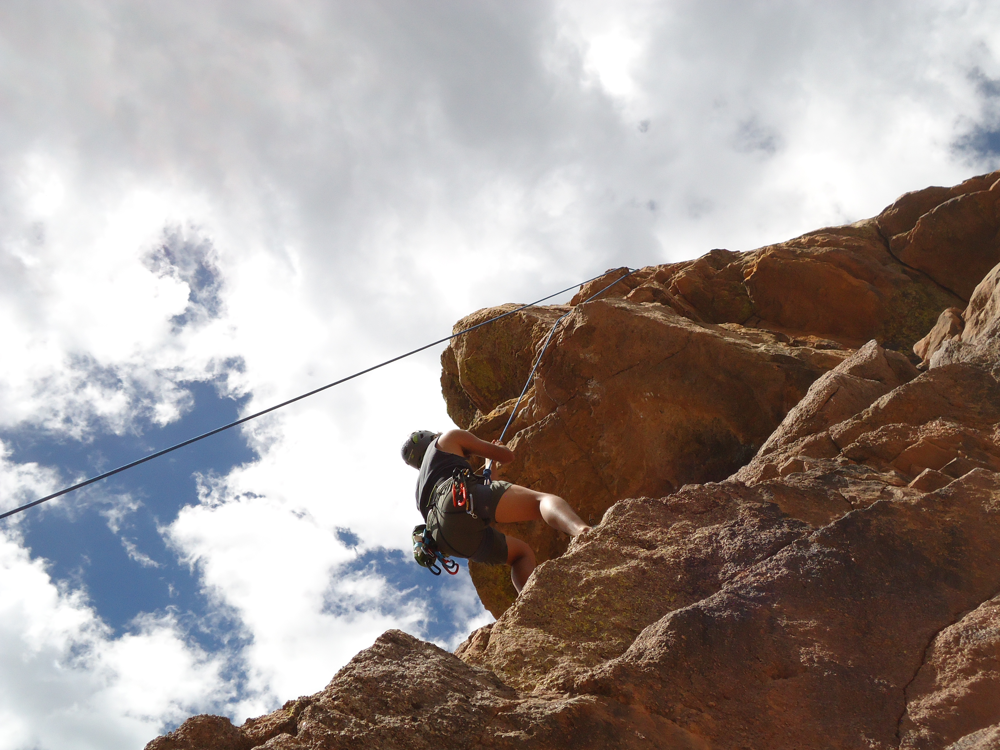

# About Me

I'm a Mechanical Engineering student at **Vanderbilt University**, pursuing a Bachelor of Engineering with an expected graduation date of May 2028. My primary interests are in aerospace engineering, mechanical design, robotics, fluid mechanics, and advanced manufacturing.

I enjoy taking engineering projects from initial concepts through CAD modeling, analytical calculations, simulation, fabrication, programming, and experimental testing. I'm particularly interested in understanding how mechanical systems behave, identifying design limitations, and improving performance through analysis and physical iteration.

My experience includes mechanical design and fabrication with Vanderbilt Motorsports, biomedical research involving precision microinjection systems, mechatronics projects, microfluidic device development, and computational modeling.

I'm interested in applying these skills to aerospace and defense engineering, particularly in mechanical design, structural analysis, hardware development, and testing.

## Education

**Vanderbilt University**  
Bachelor of Engineering in Mechanical Engineering  
Expected Graduation: May 2028

## Engineering & Professional Experience

### Undergraduate Researcher — Bellan Lab, Vanderbilt University

- Developed and calibrated experimental hardware for biomedical research involving iPSC-derived cellular systems.
- Investigated pressure-controlled microinjection, analyzing relationships between applied pressure, pulse duration, and delivered fluid volume.
- Used microscopy, Python, MATLAB, CAD, and experimental measurements to characterize system performance.
- Presented microinjector calibration research at a Vanderbilt undergraduate research symposium.

### Data Science Intern — iXperience, Cape Town, South Africa

- Worked on a client-facing project developing and evaluating a go-to-market validation framework.
- Conducted technical literature reviews and examined the methodology behind an 18-question assessment framework.
- Contributed to scoring methodology validation, data analysis, and the presentation of findings and recommendations.
- Gained experience with Python, data science workflows, and collaborative technical development.

### Rock Climbing Supervisor — City of Greeley

- Supervised climbing operations, ensuring compliance with rope safety procedures and equipment inspection requirements.
- Assisted with climbing instruction, route setting, and risk assessment.
- Worked in a safety-critical environment requiring communication, situational awareness, and sound judgment.

### STEM Tutor — Vanderbilt University | January 2025–Present

- Tutor students in Python programming, Statics, Thermodynamics, General Chemistry, and Calculus I–III.
- Help students develop analytical problem-solving skills and understand complex mathematical and engineering concepts.

## Selected Engineering Projects

### Microinjector Calibration — Biomedical Research

Developed and experimentally characterized a pressure-driven microinjection system. Analyzed the relationship between injection pressure, pulse duration, and fluid delivery using microscopy measurements, Python, and quantitative modeling.

### Pinched Flow Fractionation — Microfluidic Device Design

Designed and iterated microfluidic channel geometries intended to separate 50 µm and 150 µm particles. Applied fluid mechanics principles, hydraulic resistance calculations, CAD modeling, and additive manufacturing considerations.

### Mechanical Cam Design & Motion Analysis

Developed cam profiles using MATLAB App Designer and evaluated displacement, velocity, acceleration, jerk, pressure angle, and geometric constraints. Used SolidWorks for mechanical modeling and motion analysis to investigate cam-follower behavior and verify design performance.

### Arduino-Controlled Syringe Pump

Designed and assembled a motorized syringe pump integrating CAD-designed components, 3D printing, stepper motor control, limit switches, and Arduino programming for controlled fluid delivery.

### Quadruped Robot — Mechatronics

Developed an Arduino-controlled robotic platform integrating servo motors, ultrasonic sensing, user controls, and mechanical assemblies.

### Vanderbilt Motorsports — Formula SAE

Contributed to mechanical design, chassis fabrication, and component development for Vanderbilt's Formula SAE racing team.

## Certifications & Research Presentations

### Certifications

- **Certified SOLIDWORKS Associate (CSWA)** — Dassault Systèmes
- **Data Science Certificate** — iXperience / Gordon Institute of Business Science (GIBS), University of Pretoria

### Research Presentations

- *Microinjector Calibration for Use with iPSC-Derived GABAergic Interneurons* — Vanderbilt Undergraduate Research Symposium

## Technical Skills

### CAD & Mechanical Design

- **SolidWorks:** Part modeling, assemblies, engineering drawings, mechanical design, and design iteration
- **SolidWorks Motion Analysis:** Kinematic studies, mechanism simulation, displacement and velocity analysis, and force evaluation
- **SolidWorks Simulation:** Structural analysis, applied loads, stress and deformation evaluation, and introductory finite element analysis (FEA)
- **Autodesk Fusion 360:** Parametric CAD modeling, assemblies, and prototyping
- **Mechanical Design:** Mechanisms, cams, linkages, fasteners, geometric constraints, and component integration
- **Engineering Calculations:** Free-body diagrams, force and moment analysis, stress and strain, and factor-of-safety calculations
- **Design for Manufacturing:** Material selection, tolerances, manufacturability, and additive manufacturing considerations

### Simulation, Modeling & Engineering Analysis

- **MATLAB:** Numerical computation, engineering calculations, data processing, plotting, and custom engineering applications
- **MATLAB App Designer:** Development of interactive engineering analysis tools and graphical interfaces
- **Simulink:** Dynamic system modeling, block-diagram simulation, transfer functions, and control system analysis
- **SolidWorks Simulation:** Basic FEA, structural loading, stress distribution, and displacement analysis
- **SolidWorks Motion:** Mechanism kinematics and dynamic motion studies
- **SimScale:** Computational fluid dynamics (CFD) modeling
- **XFLR5:** Airfoil and aerodynamic analysis
- **System Dynamics:** Transfer functions, transient response, frequency response, and feedback control
- **Fluid Mechanics:** Fluid flow analysis, pressure losses, hydraulic resistance, and control-volume calculations

### Programming & Software Development

- **Python:** Numerical analysis, data processing, automation, scientific computing, and data visualization
- **MATLAB:** Mathematical modeling, numerical methods, engineering applications, and algorithm development
- **Java:** Object-oriented programming and software development
- **Arduino / C++:** Embedded programming, hardware control, and sensor integration
- **Django:** Web application development and backend programming
- **Git & GitHub:** Version control, project documentation, and software repositories
- **Data Analysis:** Experimental data processing, curve fitting, statistical analysis, and graphical interpretation

### Electronics, Controls & Mechatronics

- Arduino microcontrollers and embedded systems
- DC motors, stepper motors, and servo motor control
- Sensors, limit switches, and ultrasonic distance measurement
- Motor drivers and electronic hardware integration
- Optical encoders and position/velocity measurements
- Feedback control and PID concepts
- Circuit prototyping and basic electronic troubleshooting
- KiCad and LTspice

### Fabrication & Manufacturing

- **Additive Manufacturing:** Fused Filament Fabrication (FFF/FDM), resin-based 3D printing, and design for additive manufacturing
- **CAD-to-Prototype Development:** Design iteration, fabrication, assembly, and testing
- **Metal Fabrication:** Welding and mechanical assembly
- **Rapid Prototyping:** Functional prototypes, mechanical fixtures, and experimental apparatus
- **Manufacturing Processes:** Material extrusion, vat photopolymerization, selective laser sintering, and material jetting
- **Experimental Testing:** System calibration, measurement, data collection, and performance evaluation
- **Mechanical Assembly:** Fasteners, hardware integration, component fitting, and mechanical troubleshooting

### Research & Laboratory Techniques

- Experimental design and quantitative analysis
- Precision fluid delivery and microinjection
- Microscopy and image-based measurements
- Experimental calibration and uncertainty considerations
- Technical documentation and research presentations
- Prototype development and iterative testing

## Engineering Interests

- Aerospace & Defense Engineering
- Mechanical Design & Structural Analysis
- Robotics & Mechatronics
- Aerodynamics & Fluid Mechanics
- Dynamic Systems & Controls
- Advanced Manufacturing
- Hardware Development & Experimental Testing

## Outside Engineering

Outside of engineering, **rock climbing** is one of my biggest interests. I enjoy both indoor and outdoor climbing, particularly the technical problem-solving, physical challenges, and continuous progression involved in the sport.

Through climbing and my experience supervising climbing operations, I've also developed an appreciation for risk management, communication, teamwork, and safety-critical decision-making.

