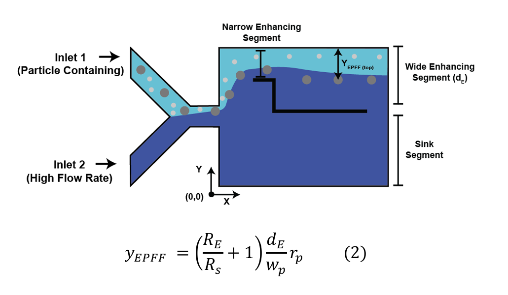
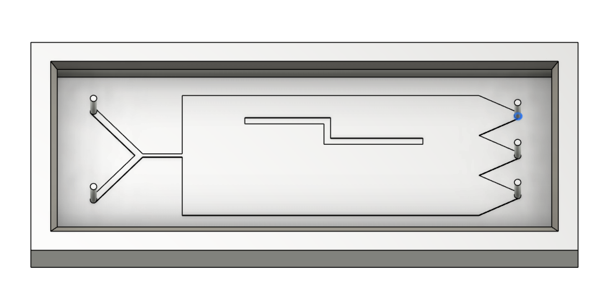
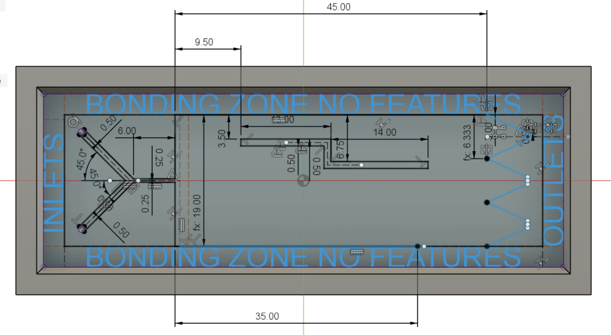
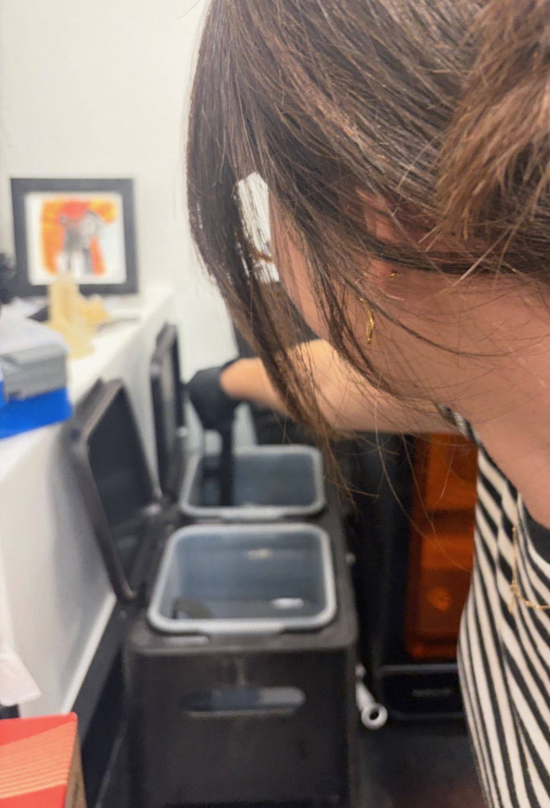
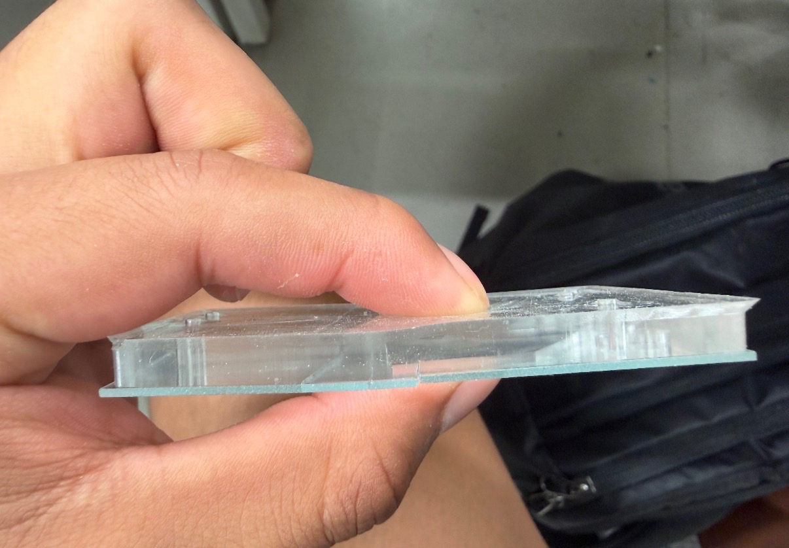
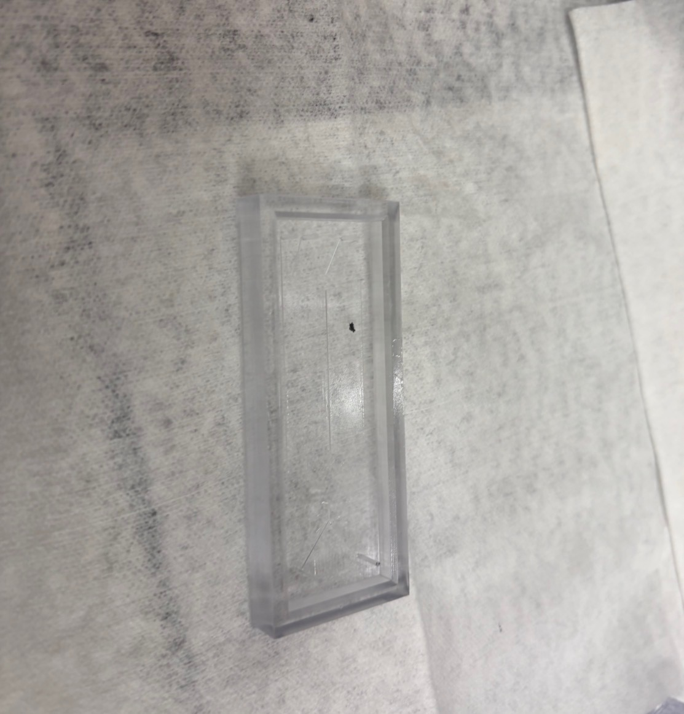

## Introduction 
Pinch flow Fractionation utilizes laminar flow of a buffer solution from one inlet and a solution containing two different sized particles from another inlet to intersect in a pinched segment.
The pinched segment results in the particle sizes to sinter with respect to their diameter size (for spheres). This sintering combined with the pinched segment is later introduced into a broadened
section to increase the distance of the particles that was created from their sintering from the pinched segment.
The particles are now separated with a certain distance determined by the width of the broadened and pinched segments, labeled below.
For this project, the concept of pinch flow fractionation is further utilized by adding an additional feature, that is the same concept of the pinched segment. We introduce another pinched segment,
referred to as an enhanced pinch flow fractionation, causing there to be more distance from the two particle sizes. This creates an issue of optimization, as the ePFF needs to be maximized,
without narrowing the width of the sink segment too much when maximizing the broadened section, which would lead to more resistance (not what is wanted). This additional feature is intended to further separate the particles by redirecting their flow paths through another constricted region, followed by additional expansion. 

How ePFF works:

## Applications of PFF 
A couple of examples of involve separating tiny particles, such as antibodies that range in the micron size. The use of PFF in this environment allows for antibodies, which are quite sensitive to be re-obtained, which is ideal considering the price of antibodies.
A better possible practical application of PFF involves separating pancreatic islets cells, which are a cluster of cells responsible for regulating blood glucose through the insulin hormone release. These islets are in a large range of sizes in the micron size, and would be valuable to obtain for transplantation. In a study by Oh et al.(2022), researchers investigated the islet recovery from surgery and how the difficulties from that were from obtaining a sufficient amount of the cells for research. 
With the use of PFF, islets could be easier to obtain by separating them into different group sizes. This is likely better than a physical filtration method as the islets are less likely to have the same issues from filtration methods. Not using filters that would clog or trap the islet cells during separation would lead to more amounts of cells being obtained for use. The study done by Nam et al.,(2010) demonstrated microfluidic devices being used to separate the islets from 50 and 250 microns. Additionally, in comparison to other applications where the sorting is important the sorting of islets is less significant, so if there is an error in sorting, then the entire PFF application would not be ruined.

Citations: 
Nam KH, Yong W, Harvat T, Adewola A, Wang S, Oberholzer J, Eddington DT. Size-based separation and collection of mouse pancreatic islets for functional analysis. Biomed Microdevices. 2010 Oct;12(5):865-74. doi: 10.1007/s10544-010-9441-2. PMID: 20549367.

Oh JY, Kim YH, Lee S, Lee YN, Go HS, Hwang DW, Song KB, Lee JH, Lee W, So S, Kang E, Jun E, Shim IK, Kim SC. The Outcomes and Quality of Pancreatic Islet Cells Isolated from Surgical Specimens for Research on Diabetes Mellitus. Cells. 2022 Jul 29;11(15):2335. doi: 10.3390/cells11152335. PMID: 35954179; PMCID: PMC9367344.

## Design 
For determining where to place the outlet boundaries for small and large particles, the readings cited below helped with particle tracking when utilizing PFF and ePFF. Using these equations to calculate the displacement of the particles, then the dimensions of the snake-like structure can be defined. The outlet boundaries were determined based on the width of the 3 particles. Since the outlet channels are all controlled by syringe pumps with variable flow rates, the dimensions for these are less significant. Therefore, each outlet channel is set to equal lengths to prevent problems with clogging in the flow path due to hydraulic resistance being set from outlet channel paths (smaller length channels have higher resistance, and larger channels have lower resistance, which would be unchanged if parameterized to certain lengths), therefore the outlet channels were left alone, and the priority was creating as much distance between the particles. 
To maximize the separation between small and large particles, the broadened section was designed to be as wide as possible, which was limited by the width of the microscope glass (25mm). Leaving room for the edges, this left the broadened with, wb, to be set to 19mm. For the enhanced broadened section, the width was attempting to make it as large as possible without shrinking the sink segment to where the resistance is too high for the sink segment. This length ended up being around 6mm. Lastly before being able to set a small dimension for the enhanced pinch width, it was necessary to track where the particles would be. Since the length off the original PFF was around 2mm, the particles set to their calculated lengths from yPFF at 2mm from the edge of the pinched segment. Calculating the yPF and adding some distance as a tolerance, the length of the enhanced pinched segment was 3.5mm. Calculating for the y ePFF, the smaller and larger particles were left with a distance of around 3.7mm apart. 
Since the snake-like structure also increases displacement of the particles from the length of the channels, the lengths were each set to around 6mm.

Instructions 
Creating the μfluidic device using resin printing involves several steps, starting with the CAD model of the channels and the mold. Once the mold is printed using resin printing (Voron 4 was used for resin printing), the mold must be washed to remove any uncured resin and then post-cured using UV light. One issue with resin printing is that residual components from the resin, including photoinitiators, can inhibit the cross-linking reaction of PDMS. Because of this, additional treatment of the mold may be necessary before casting. 
Below shows the resin models being further washed in an IPA bath to remove uncured resin streaks that remained after 10 minute wash:

The PDMS is then mixed with its curing agent, degassed to remove air bubbles, and poured over the printed mold. After curing, the PDMS is carefully removed from the mold, and holes are punched for the inlets and outlets. The PDMS and glass slide are then plasma-treated to allow the two surfaces to bond together, creating enclosed microfluidic channels.

Another important consideration when dimensioning that is relevant here, is the height of the resin model for the device. The device was set to around 0.25 mm, which might be too small. this is due to sagging of the PDMS, an example is provided below. Ideally, the height of the model is as small as the particle with some tolerance in order to preserve laminar flow, and prevent clogging or any turbulence as the yePFF equation model does not account for the 3D dimensional flow well. In further iterations, height is optimized from testing previous models to find the best working model for particles of the micron scale.

## Discussion 
Resin printing was chosen over other manufacturing techniques due to its ability to create small and complex geometries while allowing for multiple design iterations. Compared to traditional methods such as filament printing or powder printing, resin printing does not require a cleanroom and the design can have smaller dimensions. This makes it easier to modify the CAD model and print another mold if changes to the dimensions are necessary. The specs for resin printing work for dimensioning a model for the PDMS μfluidic device. Although when designing portions like the pinched segment, the segment was limited to the specs of the printer being around 50 microns, but including tolerances meant adding an extra 50 microns, which for particles of 50-150 microns is significant. 
To scale up or modify the size of the particles going through the μfluidic device, two things can be done. In order to modify the size of the particles, and even further complicated and optimized model with multiple channels can be made, to accommodate lots of particle sizes. And to scale up simply creating a μfluidic device with larger pinched segment widths would allow for larger particles to fit through.
## Multimedia 

<!-- will update once I have a picture of setup -->
 

 
μfluidic VPP Project
<!--
I will uncomment when video of demo is recorded, also I forgot to take a picture of my resin mold, which is why that is not up, apolgoies 
o Embedded YouTube video of the device working. 
<video width="100%" controls playsinline>
  <source
    src="/assets/videos/Device_Demo_ePFF.mp4"
    type="video/mp4">
  Your browser does not support video playback.
</video>
The best submissions will organize their webpage with headings, use short paragraphs (3-4 
sentences), and embed images where they are mentioned to break up text. 
-->>
